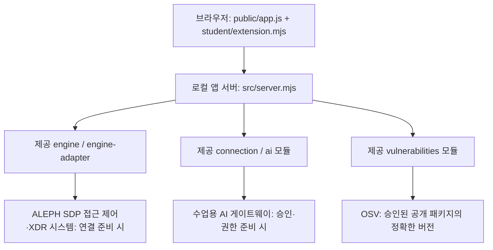

# 내이름은코난탐정이죠 — 학생 실행 설명서

## 목적과 기준

직원 본인의 사용자·기기·세션, 업무 앱 판정, 최근 접속·저장된 XDR 경보와 AI 설명·조치 상태, 설치 패키지 OSV 조회 상태를 구분해 보여 주는 로컬 보안 Agent입니다. 학생 구현 기준은 이 문서와 함께 제출하는 커밋의 `on-client/student/extension.mjs`입니다. 작성 시 대조한 코드는 `76214d5`(20단계 저장점)입니다. 이 해시는 21단계 제출 해시가 아닙니다.

기존 저장소 최상위의 1~12단계 자료실·판정기·XDR 파일과 Git 이력은 보존합니다. Vercel 자료실 배포와 이 로컬 앱의 실행은 별개입니다. 창 제목 등 제공 UI에는 케셰브라는 시작 틀 이름이 남아 있습니다.

## 환경과 버전

| 항목 | 코드 기준 및 확인 범위 |
|---|---|
| Node.js | package.json engines 기준 24.19.0. 사용자 PC v24.20.0에서 문법·기본 시작·재시작을 관찰. 명세 지원을 확대하지 않음. 이번 PC의 24.19.0 실행은 미확인 |
| 앱 | alekov-client-starter 0.2.11 |
| PowerShell | Windows PowerShell 실행 명령 사용. 실제 PowerShell 버전 번호는 미확인 |
| Git | 커밋·푸시에 사용. 실제 버전 번호는 미확인 |
| 브라우저 | PC 브라우저에서 loopback 주소 사용. 정확한 제품·버전별 호환성은 미확인 |
| npm 의존성 | on-client/package.json에 외부 의존성 없음. 실행을 위해 npm install을 요구하지 않음 |
| 설정 견본·lock | 현재 커밋의 on-client에는 .env.example과 package-lock.json이 없음. 없는 파일을 복사하거나 생성했다고 가정하지 않음 |

Node.js·Git이 준비된 PC에서 아래로 실제 버전을 확인합니다. 아직 실행하지 않은 명령의 결과를 이 문서에 채워 넣지 않습니다.

```powershell
node --version
npm --version
git --version
$PSVersionTable.PSVersion
```

## 작업 위치와 파일

Git 최상위 폴더의 PC 예시는 `C:\Users\User\Downloads\vault-step2`이며 앱 폴더는 그 아래 `on-client`입니다. 다른 PC에서는 저장소를 받은 실제 경로로 바꿉니다.

| 저장소 기준 경로 | 역할·작성 경계 |
|---|---|
| on-client/package.json | 제공 실행 명령·버전 |
| on-client/student/extension.mjs | 학생 DOM 표시 함수 8개 |
| on-client/student/engine-adapter.mjs | 제공 호스트 연결 어댑터. 학생 표시 함수와 구분 |
| on-client/public/index.html, app.js, style.css | 제공 메뉴·조회·취소·세대 검사·학생 DOM 교체 |
| on-client/src/server.mjs | 제공 loopback HTTP 서버·API |
| on-client/src/engine.mjs, src/engine/ | 제공 접근 제어·XDR 호스트 연결 |
| on-client/src/connection/, src/ai/ | 제공 계정 연결·AI 승인·설명 연결 |
| on-client/src/actions/ | 제공 조치 처리 계약. 실제 학생 집행 연결 완료를 뜻하지 않음 |
| on-client/src/vulnerabilities/ | 제공 설치 버전 대조·OSV 조회 |
| on-client/tools/ | 제공 Windows 실행·호스트 준비 도구 |
| on-client/docs/STUDENT_RUNBOOK.md | 학생 작성 실행·장애·구성 안내 |

위 표에서 `src/...` 생략 경로는 같은 `on-client` 아래입니다.

## 시작·종료·다시 실행

새 PowerShell 창에서 앱 폴더로 이동합니다. System32나 저장소 최상위에서 npm start를 실행하지 않습니다.

```powershell
cd "$env:USERPROFILE\Downloads\vault-step2\on-client"
Get-Location
Test-Path .\package.json
Test-Path .\student\extension.mjs
npm run check
npm start
```

두 Test-Path의 기대 출력은 True입니다. check는 학생 파일 문법 검사이며 기능·연결 성공 검사가 아닙니다. npm start는 package.json의 `node src/server.mjs`를 실행합니다. 정상 시작 신호는 `케셰브 연결 확인: http://127.0.0.1:5189` 출력과 브라우저에서 앱 화면이 열리는 것입니다. 출력의 ‘연결 확인’은 실제 엔진·AI 연결 성공을 증명하지 않습니다.

브라우저에서 http://127.0.0.1:5189 를 엽니다. PowerShell 창은 유지합니다. 기본 실행의 연결 없음은 실제 엔진 설정이 없는 상태이며 임의의 정상 사용자로 바꾸지 않습니다.

종료는 서버를 실행한 창에서 Ctrl+C입니다. 다시 실행할 때 같은 폴더에서 npm start를 실행하고 브라우저를 다시 엽니다. 다른 서비스나 출처가 불분명한 node 프로세스를 종료하지 않습니다.

제공 실행 도구를 사용할 수도 있습니다. npm start와 동시에 켜지 않습니다.

```powershell
powershell -NoProfile -ExecutionPolicy Bypass -File .\tools\start-alekov.ps1
```

이 도구는 켜짐을 확인한 뒤 `케셰브가 켜졌습니다`와 주소를 안내합니다. 포트가 사용 중이면 기존 앱인지 확인하거나 문서화된 `-Port 5190`으로 별도 실행하고 그 주소를 사용합니다. 다른 프로그램을 강제로 종료하지 않습니다.

예제 자료만 확인하려면 기존 서버를 종료한 뒤 `npm run demo`를 실행합니다. demo는 실제 연결·AI 호출·보안 조치의 증거가 아닙니다.

## 개인 연결 설정의 경계

계정·AI 승인용 NativeHostConfig와 본인·기기·기록용 SdpHostConfig는 별도입니다. 이미 준비한 Native 설정으로 켜는 사용자 PC 명령은 아래와 같습니다. 파일이 실제로 준비된 경우에만 사용합니다.

```powershell
powershell -NoProfile -ExecutionPolicy Bypass -File .\tools\start-alekov.ps1 -NativeHostConfig "$env:LOCALAPPDATA\AlekovNativeHost\native.json"
```

이 설정 파일은 저장소 밖에 보관합니다. 내용·확인 번호·비밀번호·토큰·키를 Git, 문서, 캡처, 원문 묶음에 넣지 않습니다. 새 환경의 준비는 제공 docs/AI_SETUP_GUIDE.md와 tools/prepare-native-host.ps1 안내를 대조합니다. 워크벤치 키를 복사하지 않습니다. SDP 설정을 발급받지 않았으면 경로나 자격을 만들어 넣지 않고 담당자에게 확인합니다. .env 자동 로딩을 가정하지 않습니다.

계정 연결 확인 → AI 앱 승인 → 현재 API 연결 점검 → 사건 설명은 서로 다른 결과입니다. 계정 연결 성공만으로 뒤 단계 성공을 기록하지 않습니다. 재실행 후 현재 상태는 제공 화면에서 다시 확인합니다.

## 글로 쓴 시스템 구성도



브라우저는 http://127.0.0.1:5189 의 로컬 앱 서버에 요청합니다. `/api/me`, `/api/apps`, `/api/events`, `/api/devices`, `/api/sessions`와 `/api/access`는 제공 엔진 연결을 사용합니다. 엔진 출처는 ALEPH SDP이며 학생이 엔진 자체를 구현한 것으로 표시하지 않습니다. 미연결 어댑터는 disconnected입니다.

AI 점검·설명은 `/api/ai/check`, `/api/ai/explain`을 통해 로컬 서버와 제공 AI 모듈이 처리합니다. 브라우저가 원본 AI 키로 외부 모델을 직접 호출하지 않습니다. 수업용 AI 게이트웨이와 코딩을 돕는 워크벤치 AI, 제출 코드를 읽는 ALEPH 과제 판정 AI는 역할이 다릅니다. 실제 AI 승인·설명 성공은 미확인입니다.

패키지 조회는 `/api/vulnerabilities`를 통해 서버가 처리합니다. 서버는 준비된 프로젝트의 lock과 설치 메타데이터를 대조하고 허용된 공개 패키지만 `https://api.osv.dev/v1/querybatch`로 조회합니다. 학생 표시 함수는 받은 결과만 표시하며 외부 요청·패키지 설치·업데이트를 하지 않습니다.

공통 입력은 status·mode·data·error이며, 표시 함수는 새 DOM을 반환합니다. 제공 app.js가 이전 학생 DOM을 교체하고 취소·새 요청 세대로 늦은 응답을 차단합니다. 화면의 성공 문구는 실제 연결 증거를 대신하지 않습니다.

## 학생 함수와 확인 범위

| 함수 | 학생 표시 구현 | 확인 근거·미확인 |
|---|---|---|
| renderIdentity | 사용자·기기·세션과 원래 상태 코드, 실패 시 이전 값 제거 | 사용자 demo 화면·이전 값 제거 보고, 코드 확인. 실제 SDP 신원 조회 미확인 |
| renderDecision | idle/loading, 네 판정·이유·시각, 요청 실패 구분 | 코드 확인. 현 계정의 실제 업무 앱 판정 미확인 |
| renderEvents | 받은 배열 복사·최신순·세 필터·근거/규칙/세 상태 상세 | 모의 DOM·코드 확인. 실제 최근 40건 조회 미확인 |
| renderStatus | 기기·세션·알림·안전한 진단 필드, 사용자 클릭 복사 | 코드·모의 점검. 모든 실제 오류·클립보드 동작 미확인 |
| renderAiConnection | 시험/권한 확인 점검, 모델 수·시각, 오류·수동 재점검 | 코드·모의 점검. 실제 AI 승인·모델 응답 미확인 |
| renderExplanation | 현재 사건 근거 ID 대조, 규칙·unknown·미실행 제안 | 코드·모의 점검. 실제 AI 사건 설명 미확인 |
| renderAction | 준비·전송·ACK·효과 관측 구분, unknown 재조회 안내 | 코드·모의 점검. 실제 보안 조치 미실행 |
| renderVulnerabilities | 전체/패키지 상태·정확한 버전·OSV ID·부분 실패 보존 | 사용자 문법 검사·PROJECT_NOT_CONFIGURED 보고. 실제 버전/OSV 조회 미확인 |

모의 점검은 개발 중 합성 입력과 DOM 모형으로 수행한 확인이며 PC의 실제 시스템 연결·공식 통과 증거가 아닙니다. 메뉴의 마우스·키보드 이동은 사용자 확인 보고가 있으나 이번 문서를 따라 새 창에서 재현하는 검사는 미확인입니다.

## 장애 확인·복구 순서

| 상황 | 확인 순서 | 복구·남길 결과 |
|---|---|---|
| ENOENT / 경로 없음 | Get-Location, Test-Path로 on-client인지 확인 | 올바른 폴더로 이동 후 같은 명령 재실행 |
| SyntaxError | npm run check의 첫 오류 위치, 학생 파일 변경 비교 | 해당 함수만 수정하고 check. 제공 파일 덮어쓰지 않음 |
| 포트 사용 중 / EADDRINUSE | 기존 서버 창·열려 있는 앱 확인 | 기존 앱 사용 또는 제공 도구 -Port. 다른 서비스 보존 |
| ENGINE_NOT_CONNECTED | 시작 옵션·제공 어댑터·현재 화면 mode 확인 | 담당자가 준비한 SDP 연결 확인. demo로 성공을 대신하지 않음 |
| NATIVE_HOST_DISABLED | NativeHostConfig 옵션과 파일 존재 확인 | 준비된 개인 설정 경로로 서버 재실행. 키 내용은 출력하지 않음 |
| ALEKOV_CONNECT_RESPONSE_INVALID | AI 연결 완료가 아닌 응답 확인 불가로 기록 | 이미 승인했을 수 있으면 제공 상태 다시 확인 사용. 반복 발급·대체 키 연결 없이 담당자 확인 |
| AI 인증·한도·시간 초과·취소 | 학생 칸의 안전한 code/message 확인 | 권한·한도는 담당자 확인, 재시도는 직접 버튼 사용. 이전 결과를 현재 성공으로 남기지 않음 |
| PROJECT_NOT_CONFIGURED | 학생 칸 not_configured와 제공 화면 비교 | 프로젝트 설정은 담당자 준비. 취약점 없음으로 바꾸지 않음 |
| not_checked / unverifiable / partial | 승인 대상·lock 확인 상태·받은 ID 표시 확인 | 설정 임의 변경·의존성 하향 금지. 이미 받은 취약점 ID 보존, 실패 범위 기록 |

수동 확인 순서는 보호 현황 → 업무 앱 → 보안 기록입니다. 단계별로 실제 반환된 결과만 기록하며 없는 사용자를 만들거나 정책·인증을 변경해 결과를 꾸미지 않습니다. 조치 버튼이 없는 현재 supportedActions 빈 배열은 정상 범위입니다. 취소는 이미 전달된 조치의 효과를 되돌리지 않습니다.

## 보존·되돌리기·제출

이번 단계는 학생 문서와 README 링크만 변경합니다. UI·제공 서버·인증·이전 학생 함수는 바꾸지 않습니다. 변경을 되돌릴 필요가 있으면 git status와 git diff로 다른 작업과 구분한 뒤 문서 변경만 검토합니다. reset --hard나 전체 파일 덮어쓰기로 이전 작업을 지우지 않습니다.

Git 최상위에서 git status --short, git diff --stat, git diff -- on-client/README.md on-client/docs/STUDENT_RUNBOOK.md로 확인하고 두 문서만 선택해 커밋합니다. 제출 해시는 커밋 후 git rev-parse HEAD로 읽으며 만들어 쓰지 않습니다. 비밀 파일은 추가하지 않습니다.

21·22단계는 과제 화면에 저장소와 40자리 커밋을 직접 입력합니다. 비공개 원문이 필요하면 해당 단계의 공식 원문 전달 도구를 프로젝트 밖에 풀고 출력 폴더도 밖에 만듭니다. 정확한 student-source-cli.mjs 인자는 과제 화면의 안내를 따릅니다. 이 문서에서는 받지 않은 도구 명령을 추측하지 않습니다. 원문 전달과 AI 검토 통과는 별도이며 제출은 사용자가 확인해 직접 진행합니다.

## 22단계 버전 안내 정정

명세 기준 Node.js는 package.json의 24.19.0입니다. 24.20.0은 학생 PC에서 관찰한 버전이며 명세 지원 버전으로 추가하지 않습니다. 제공 도구가 허용하는 22~24는 실행 전 검사 범위일 뿐 검증된 지원 범위가 아닙니다. 학생 문서는 22~24 전체 지원을 주장하지 않습니다. 제출 커밋 0cdab87의 실행 기록과 미확인 범위는 [학생 릴리스 기록](STUDENT_RELEASE.md)에 분리했습니다.
